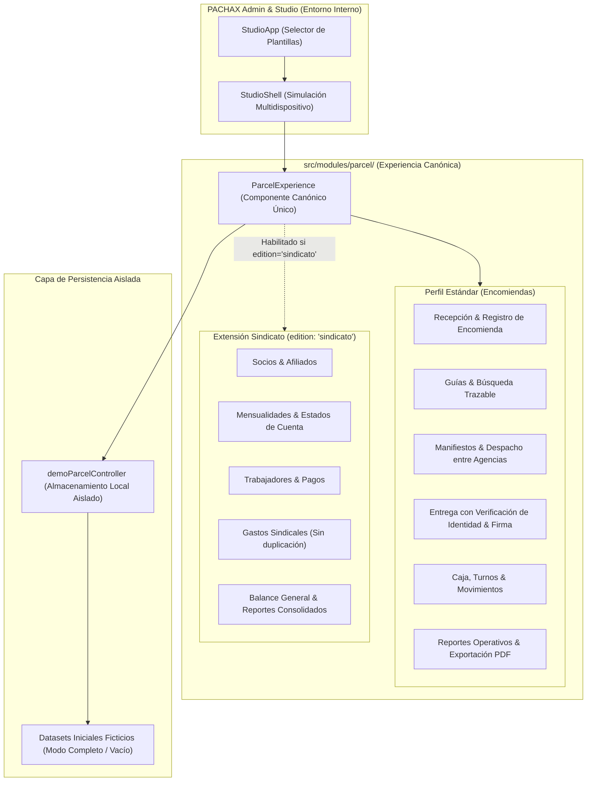

# Plan de Arquitectura e Implementación: PACHAX Encomiendas + Edición Sindicato

## 1. Contexto y Objetivos

- **Rama de trabajo:** `gemini/encomiendas-sindicato-demo` basada en `origin/main` (`b9f47ce`).
- **Propósito:** Desarrollar una nueva plantilla integral **PACHAX Encomiendas** para empresas de encomiendas, transporte y logística en Bolivia, con dos perfiles de funcionamiento:
  1. **Perfil Estándar:** Encomiendas autoservicio (recepción, clientes, guías QR, manifiestos de despacho, entrega en agencia/domicilio con firma, arqueo de caja y comprobantes PDF/térmicos).
  2. **Perfil Sindicato:** Extensión administrativa para sindicatos de transporte (afiliados/socios, cuotas mensuales, personal/trabajadores, gastos operativos y balances consolidados).
- **Aislamiento absoluto:**
  - `PUBLIC_TEMPLATES` se mantiene con sus 5 plantillas públicas intactas (cero impacto en landing, registro público, catálogo comercial de Codex, etc.).
  - Visibilidad interna exclusiva dentro de **PACHAX Admin / Studio**.
  - Sin conexiones a Firebase Producción ni llamadas a Cloud Functions externas.
  - Lógica desacoplada y preparada para empaquetado de escritorio local (Tauri / Electron + SQLite).

---

## 2. Diagrama de Arquitectura de Módulos

---

## 3. Estructura de Archivos a Desarrollar

1. **Contratos & Tipos de Dominio:**
   - `src/modules/parcel/types.ts`: Tipos canónicos (encomiendas, clientes, agencias, manifiestos, estados de trazabilidad, socios, cuotas, personal, caja).
   - `src/modules/parcel/domain/parcelEngine.ts`: Reglas de negocio puras (generación de guías, transiciones de estado, cálculo de tarifas, desduplicación de ingresos/egresos, balances).
2. **Servicios de Documentos e Impresión:**
   - `src/modules/parcel/domain/parcelDocuments.ts`: Generación de guías de recepción (ticket térmico 58/80 mm y A4), comprobantes de cuota, constancias de entrega y reportes en PDF descargables e imprimibles mediante `jspdf` y `jspdf-autotable`.
3. **Controlador y Datasets de Simulación:**
   - `src/demo/datasets/parcel/parcelDatasets.ts`: Semillas ficticias de agencias bolivianas (Cochabamba, La Paz, Santa Cruz, etc.), encomiendas activas, socios, trabajadores y movimientos.
   - `src/demo/parcel/demoParcelController.ts`: Controlador de estado reactivo local con soporte de reinicio, cambios de escenario (completo / vacío) y persistencia en sesión aislada.
4. **Vistas e Interfaz Canónica:**
   - `src/modules/parcel/views/ParcelExperience.tsx`: Shell principal con selector de perfiles (Estándar vs Sindicato), barra de navegación simple con botones táctiles grandes, buscador rápido y modales directos.
   - `src/modules/parcel/components/NewParcelModal.tsx`: Formulario ágil de nueva encomienda con descripción declarada, advertencia de materiales peligrosos y cálculo automático.
   - `src/modules/parcel/components/ParcelReceptionTicket.tsx`: Vista previa de impresión térmica/A4 y descarga PDF.
   - `src/modules/parcel/components/ParcelDispatchManifestModal.tsx`: Creación y control de salidas entre agencias.
   - `src/modules/parcel/components/ParcelDeliveryModal.tsx`: Verificación de identidad y captura de firma.
   - `src/modules/parcel/components/SyndicateMembersView.tsx`: Gestión de socios y estados de cuenta.
   - `src/modules/parcel/components/SyndicateDuesView.tsx`: Control de mensualidades, cobros y comprobantes.
   - `src/modules/parcel/components/SyndicateWorkersView.tsx`: Personal, sueldos y adelantos.
   - `src/modules/parcel/components/SyndicateExpensesView.tsx`: Gastos generales con clasificación anti-duplicación.
   - `src/modules/parcel/components/ParcelReportsView.tsx`: Todos los reportes con exportación PDF e impresión nativa.
5. **Integración Exclusiva en Admin / Studio:**
   - `src/studio/studioTemplates.ts`: Catálogo ampliado interno para Studio que conserva intacto `PUBLIC_TEMPLATES`.
   - `src/studio/StudioHome.tsx`: Registro visual de "PACHAX Encomiendas" con selección de Perfil Estándar y Perfil Sindicato.
   - `src/studio/StudioShell.tsx`: Manejo de la plantilla `parcel` y renderizado de la experiencia canónica.
   - `src/demo/parcel/ParcelDemo.tsx`: Adaptador de la demo para Studio.
6. **Pruebas Automatizadas:**
   - `tests/parcelDomain.test.ts`: Pruebas de reglas de negocio, guías, tarifas, transiciones de estado, caja, cuotas y personal.
   - `tests/parcelIsolation.test.ts`: Comprobación de que no se expone a rutas públicas ni modifica el catálogo comercial de las 5 plantillas públicas.
