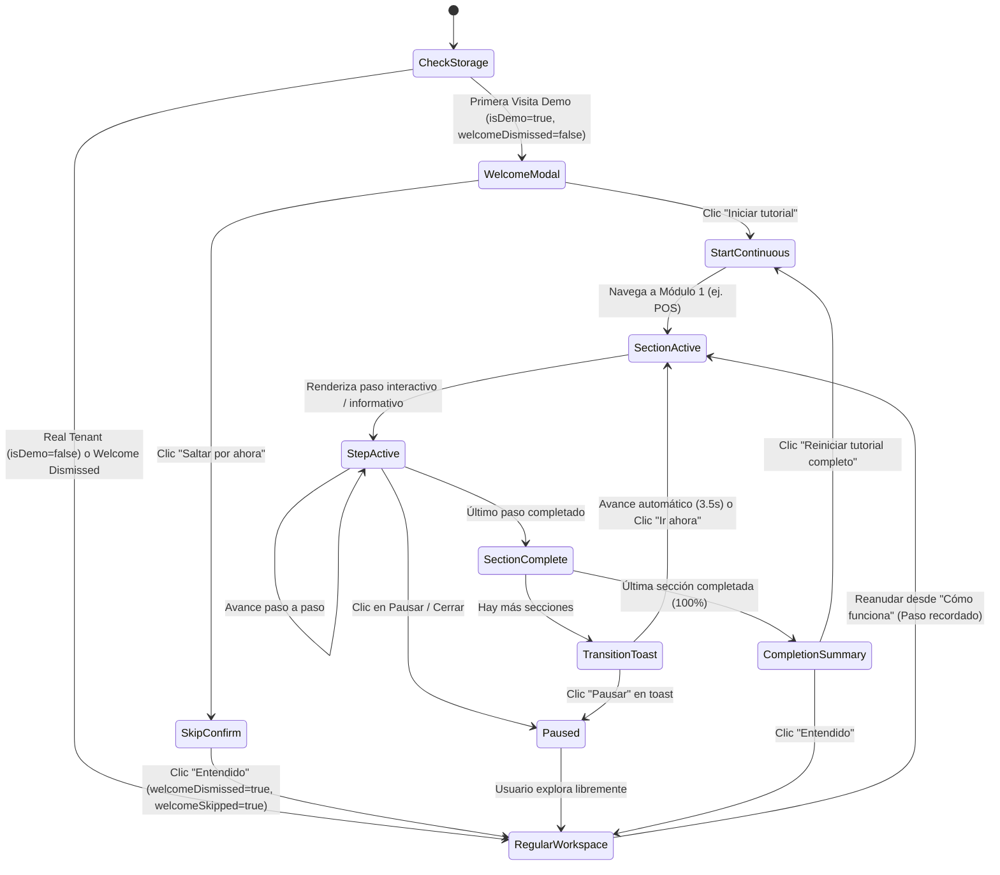

# PACHAX PLATFORM — INFORME TÉCNICO G6
## Onboarding Inteligente y Experiencia Continua de Tutoriales para Demos Existentes

**Autor:** Antigravity / Gemini Core Platform Assistant  
**Fecha de Certificación:** 27 de octubre de 2026  
**Rama:** `gemini/g6-seamless-tutorial-experience`  
**Base:** `origin/main` (`a2d821f549200463fc001afbb2a718ed48c8d724`, post merge PR #1)  
**Worktree:** `C:\PACHAX-worktrees\gemini-g6-seamless-tutorial`

---

## 1. Resumen Ejecutivo

Durante la fase G6 se diseñó e implementó la arquitectura de **Onboarding Inteligente y Tutoriales Continuos** para todas las experiencias interactivas disponibles en PACHAX Platform:
1. **Restaurante con salón** (`restaurant_pos` en modo salón completo, 11 recorridos autorizados).
2. **Restaurante de Servicio Rápido** (`restaurant_pos` en modo `counter_service`, 10 recorridos optimizados sin módulo de Mesas).
3. **Producción y Distribución** (`route_distribution` en sus 9 perfiles sectoriales comerciales).

### Logros Principales
- **Recorrido fluido y unificado sin interrupciones:** El visitante inicia el tutorial una sola vez al ingresar a la demo y el sistema lo acompaña de módulo en módulo de forma guiada y continua, sin forzarlo a retornar al centro de aprendizaje entre secciones.
- **Modal de Bienvenida Inteligente y no invasivo (`TutorialWelcomeModal`):** Al detectar una primera visita a una demo, se presenta una tarjeta compacta y accesible que informa el rol, la cantidad de secciones y permite «Iniciar tutorial» o «Saltar por ahora» con confirmación educada que recuerda la disponibilidad permanente desde «Cómo funciona».
- **Máquina de estados desacoplada (`useTutorialOrchestrator`):** Soporta pausar, reanudar en el paso exacto («Continuar donde lo dejaste»), avanzar manualmente o esperar la lectura del usuario, saltar secciones y reiniciar completamente («Reiniciar tutorial completo»).
- **Aislamiento riguroso de almacenamiento:** El progreso y las preferencias se aíslan bajo el esquema `pachax:tutorial-orchestrator:${env}:${tenant}:${tpl}:${dataMode}:${prof}:${role}:v1`, garantizando cero contaminación cruzada entre pestañas, modos (`full` vs `empty`), rubros o roles.
- **Protección estricta de cuentas productivas:** Las empresas reales registradas en Firestore (`isDemo === false`) cuentan con guardas estrictas que impiden mostrar mensajes de bienvenida o crear estados ficticios, preservando intacta la operación comercial de los clientes.

---

## 2. Diagnóstico del Sistema Previo

Antes de la implementación de G6:
- Existían múltiples recorridos interactivos (`restaurantPosTour`, `restaurantTablesTour`, `restaurantKitchenTour`, etc.) desarrollados en fases anteriores (G4, G4.1, G4.2, G5), pero se encontraban fragmentados: el usuario debía abrir manualmente el Centro de Aprendizaje o la Guía de Configuración para lanzar cada recorrido de manera individual.
- Al terminar un recorrido (ej. POS), el tour se cerraba y el usuario quedaba en la pantalla sin orientación inmediata sobre qué módulo correspondía explorar a continuación.
- En Distribución, los tutoriales estaban organizados por rol y perfil industrial, pero no existía un flujo guiado continuo que enlazara los módulos de despacho, ruta, ventas, créditos y cierre en una sola sesión progresiva.
- En cuentas reales, se requería una delimitación clara para que los nuevos componentes de onboarding de demostración nunca interfirieran con usuarios reales de producción.

---

## 3. Arquitectura del Onboarding Inteligente



### Componentes Diseñados

| Componente | Ruta | Responsabilidad |
| :--- | :--- | :--- |
| `useTutorialOrchestrator` | [`src/components/tutorials/useTutorialOrchestrator.ts`](file:///c:/PACHAX-worktrees/gemini-g6-seamless-tutorial/src/components/tutorials/useTutorialOrchestrator.ts) | Hook React desacoplado que gobierna la máquina de estados, persistencia, transiciones entre módulos y ciclo de vida de la secuencia. |
| `TutorialWelcomeModal` | [`src/components/tutorials/TutorialWelcomeModal.tsx`](file:///c:/PACHAX-worktrees/gemini-g6-seamless-tutorial/src/components/tutorials/TutorialWelcomeModal.tsx) | Diálogo inicial accesible (`role="dialog"`) con conteo de módulos, insignia de rol, acción primaria («Iniciar tutorial») y secundaria («Saltar por ahora»). |
| `TutorialSectionTransition` | [`src/components/tutorials/TutorialSectionTransition.tsx`](file:///c:/PACHAX-worktrees/gemini-g6-seamless-tutorial/src/components/tutorials/TutorialSectionTransition.tsx) | Toast flotante elegante (`z-[1100]`) que notifica el éxito del módulo completado e introduce el módulo entrante con temporizador visual, «Ir ahora» y «Pausar». |
| `TutorialCompletionSummaryModal` | [`src/components/tutorials/TutorialCompletionSummaryModal.tsx`](file:///c:/PACHAX-worktrees/gemini-g6-seamless-tutorial/src/components/tutorials/TutorialCompletionSummaryModal.tsx) | Modal de felicitación por el 100% de avance, métricas consolidadas, repetición de secciones individuales y reinicio total. |
| `tutorialOrchestratorStorage` | [`src/components/tutorials/tutorialOrchestratorStorage.ts`](file:///c:/PACHAX-worktrees/gemini-g6-seamless-tutorial/src/components/tutorials/tutorialOrchestratorStorage.ts) | Utilidades de serialización, recuperación resiliente ante JSON corrupto y generación determinista de claves de almacenamiento. |
| `tutorialOrchestratorTypes` | [`src/components/tutorials/tutorialOrchestratorTypes.ts`](file:///c:/PACHAX-worktrees/gemini-g6-seamless-tutorial/src/components/tutorials/tutorialOrchestratorTypes.ts) | Tipos canónicos del orquestador: `TutorialStorageScope`, `TutorialOrchestratorState`, `TutorialSectionItem`, `ContinuousTransitionState`. |

### Esquema Canónico de Claves
```
pachax:tutorial-orchestrator:${env}:${tenant}:${tpl}:${dataMode}:${prof}:${role}:v1
```
- `env`: `'demo'` para entornos de demostración; `'tenant'` para cuentas productivas.
- `tenant`: Identificador de empresa (ej. `'demo-tenant-restaurant'`, `'demo-distribution-tenant'`).
- `tpl`: Plantilla canónica (`'restaurant'`, `'hamburger'`, `'distribution'`).
- `dataMode`: Ámbito de dataset (`'full'` vs `'empty'`).
- `prof`: Perfil funcional (`'restaurant'`, `'counter_service'`, o perfiles sectoriales `'food'`, `'beverages'`, etc.).
- `role`: Rol simulado activo (`'owner'`, `'admin'`, `'cashier'`, `'waiter'`, `'kitchen'`, etc.).
- `v1`: Versión del esquema de persistencia.

---

## 4. Adaptación por Plantilla y Perfil

### A. Restaurante con Salón (`restaurant_pos`, Modo Salón)
- **Rol evaluado:** Dueño / Administrador.
- **Secciones continuas (11 recorridos):**
  1. `pos` (Punto de Venta y apertura de mesas)
  2. `tables` (Mapa del salón y estados de mesas)
  3. `kitchen` (Gestión de comandas en cocina)
  4. `cash` (Arqueo y control de caja)
  5. `products` (Catálogo comercial)
  6. `inventory` (Existencias e insumos)
  7. `customers` (Fidelización y clientes)
  8. `history` (Historial de ventas)
  9. `users` (Gestión de personal y roles)
  10. `settings` (Configuración del negocio)
  11. `printers` (Impresión térmica y comandas)

### B. Restaurante de Servicio Rápido (`restaurant_pos`, Modo Mostrador)
- **Perfil:** `counter_service` (Hamburguesería / Comida Rápida).
- **Invariante crítico:** **El módulo y recorrido de Mesas (`tables`) queda estrictamente excluido.**
- **Secciones continuas (10 recorridos):**
  1. `counter_pos` (Pedidos rápidos de mostrador, para llevar y delivery)
  2. `kitchen` (Despacho ágil en cocina)
  3. `cash` (Caja rápida)
  4. `products` (Productos y combos)
  5. `inventory` (Control de stock)
  6. `customers` (Registro rápido de clientes)
  7. `history` (Historial de tickets)
  8. `users` (Turnos y personal)
  9. `settings` (Ajustes de local)
  10. `printers` (Tickets de mostrador y comandas)

### C. Producción y Distribución (`route_distribution`)
- **Adaptación sectorial:** Integración completa con los 9 rubros industriales (Alimentos, Bebidas, Lácteos, Farmacia, Limpieza, etc.).
- **Secciones continuas:** Vinculadas al catálogo de recorridos del rol activo (`distributor`, `warehouse`, `accounting`, `admin`, `support`), navegando dinámicamente entre `dist.dashboard`, `dist.sales`, `dist.credits`, `dist.dispatches`, `dist.inventory` y `dist.closure`.

---

## 5. Aislamiento Tenant y Seguridad de Producción

En cumplimiento estricto de las directivas operativas de PACHAX:
1. **Guarda absoluta `isDemo === false`:**
   En [`src/components/tutorials/useTutorialOrchestrator.ts`](file:///c:/PACHAX-worktrees/gemini-g6-seamless-tutorial/src/components/tutorials/useTutorialOrchestrator.ts#L77-L83), `isWelcomeOpen` valida inmediatamente:
   ```typescript
   if (!scope.isDemo) return false
   ```
   Un usuario autenticado en una empresa real de producción jamás recibirá el modal de bienvenida de demostración ni verá alterado su flujo de trabajo.
2. **Cero operaciones ficticias hacia Firestore:**
   Los tutoriales son puramente pedagógicos y de inspección en demo; ningún clic durante el recorrido genera escrituras no autorizadas en colecciones de producción.
3. **No serialización de Base64:**
   Se preserva íntegramente la arquitectura de IndexedDB y desinfección de Base64 certificada en G5.2 (`sanitizeProductsForStorage`).

---

## 6. Evidencia de Pruebas y Verificación

### A. Pruebas Unitarias
- **Orquestador y Persistencia:** [`tests/tutorialOrchestrator.test.ts`](file:///c:/PACHAX-worktrees/gemini-g6-seamless-tutorial/tests/tutorialOrchestrator.test.ts)
  - `G6.1 — Storage Key Generation & Strict Scope Isolation`: PASS
  - `G6.2 — Storage Persistence, Fallbacks & Error Recovery`: PASS
  - `G6.3 — Continuous Progression State Transitions Invariants`: PASS
  - `G6.4 — Real Tenant Security Invariant`: PASS
- **Pruebas de Dominio Restaurante:** 117/117 pruebas pasadas en `npm run test:restaurant`.
- **Pruebas de Tutoriales Distribución:** 18/18 pruebas pasadas en `tests/distributionTutorials.test.ts`.
- **Pruebas de Motor de Distribución:** 59/59 pruebas pasadas en `npm run test:distribution`.
- **Frontera de Producción:** [`tests/restaurantProductionBoundary.test.ts`](file:///c:/PACHAX-worktrees/gemini-g6-seamless-tutorial/tests/restaurantProductionBoundary.test.ts) verificado (cero importaciones de `src/demo/**` en módulos de producción).

### B. Pruebas de Compilación y Empaquetado Aislado
- `npm run typecheck` (`tsc -b`): **0 errores.**
- `npx eslint`: **0 errores, 0 advertencias.**
- `npm run test:demos-only:guard`: **PASS.**
- `npm run build:demos-only`: Compilación limpia en 4.54s, 92 artefactos generados, 0 referencias prohibidas.
- `npm run build:emulator`: Compilación limpia de cliente (`dist/`) e integración de demos aisladas.

### C. Pruebas E2E en Navegador Real (Chrome CDP)
Ejecutadas mediante [`scripts/test-g6-browser.mjs`](file:///c:/PACHAX-worktrees/gemini-g6-seamless-tutorial/scripts/test-g6-browser.mjs):
- **Caso 1 (Restaurante con salón, Desktop 1440×900):** Modal de bienvenida detectado, 11 secciones, inicio continuo a POS verificado. Banner de reanudación y reinicio en Centro de Aprendizaje verificado.
- **Caso 2 (Restaurante Rápido, Mobile 390×844):** Modal de bienvenida mobile detectado, 10 secciones sin Mesas, flujo de «Saltar por ahora» y confirmación verificado.
- **Caso 3 (Distribución, Desktop 1440×900):** Modal de bienvenida de distribución con tracks sectoriales verificado.
- **Caso 4 (Resumen de Finalización):** Estado 100% completado verificado.

### D. Métricas y Capturas de Pantalla Generadas
Almacenadas en el directorio de artefactos:
- Métricas: [`g6-verification-metrics.json`](file:///C:/Users/fabri/.gemini/antigravity/brain/40ec324b-7de2-4d03-b5ca-22638c551a00/g6-verification-metrics.json)
- Capturas:
  1. `g6-restaurant-salon-welcome-desktop-1440x900.png`
  2. `g6-restaurant-salon-continuous-pos-desktop-1440x900.png`
  3. `g6-restaurant-salon-learning-center-resume-desktop-1440x900.png`
  4. `g6-fastfood-welcome-mobile-390x844.png`
  5. `g6-distribution-welcome-desktop-1440x900.png`
  6. `g6-completion-summary-desktop-1440x900.png`

---

## 7. Conclusiones y Recomendaciones

La arquitectura de Onboarding Inteligente G6 eleva significativamente el nivel de la experiencia interactiva en PACHAX Platform:
- Elimina la fricción de navegación manual entre módulos.
- Brinda autonomía y claridad pedagógica al usuario interesado o cliente potencial.
- Respeta estrictamente los límites de roles y características de cada plantilla.
- No introduce deuda técnica ni altera la lógica comercial ni de backend.

Se recomienda mantener esta base desacoplada (`useTutorialOrchestrator`) como estándar cuando en futuras fases se consoliden las plantillas de Comercio Minorista (Retail) y Club Nocturno (Nightclub).
