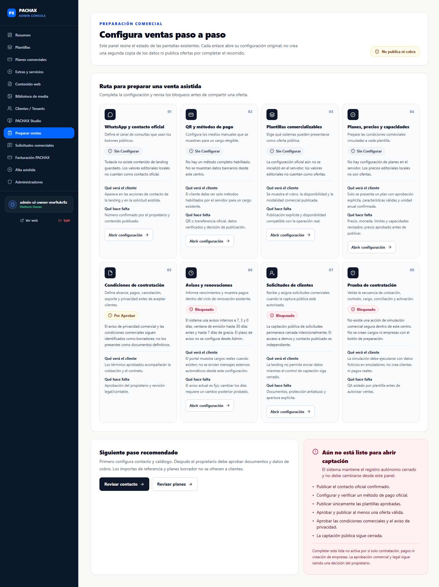
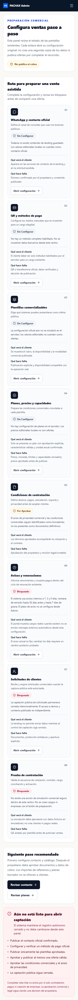

# Preparar ventas desde Administración

Este recorrido está disponible para el rol **Platform Owner** en la opción **Preparar ventas** del menú de PACHAX Admin. Resume el estado de las configuraciones existentes y enlaza a sus pantallas originales. No crea una segunda configuración y no publica planes, recibe solicitudes ni cobra.

## Pantalla de inicio

Los estados se calculan a partir de los documentos comerciales leídos desde el servidor, la respuesta de los métodos de cobro y los controles actuales de la aplicación. Si un dato no se puede consultar, se muestra como no disponible; no se reemplaza por valores editoriales.

## Ruta de configuración

1. **WhatsApp y contacto oficial**: abre **Contenido web** y configura el número confirmado. El cliente lo verá en los botones públicos que correspondan. Si el contacto no está guardado/publicado, esos botones deben mantenerse cerrados. Confirma el número con el propietario antes de publicarlo.
2. **QR y métodos de pago**: abre **Facturación PACHAX**. La pantalla existente permite configurar métodos manuales. Un método marcado como disponible por el servidor no sustituye la comprobación bancaria del titular, cuenta o QR.
3. **Plantillas comercializables**: abre **Plantillas**. Publicación editorial y disponibilidad comercial son datos distintos; una demo por sí sola no habilita una oferta.
4. **Planes, precios y capacidades**: abre **Planes comerciales**. El centro cuenta únicamente planes aceptados por el filtro del catálogo público. Los borradores y precios de referencia no se cuentan como ofertas.
5. **Condiciones de contratación**: no hay un editor de términos aprobados en Admin. El aviso de privacidad y las condiciones comerciales se mantienen como borradores sujetos a revisión del propietario y asesoría legal/contable.
6. **Avisos y renovaciones**: la política vigente incluye avisos internos a 7, 3 y 0 días, emisión de renovación en la ventana existente de 30 días y 7 días de gracia. El número de días de anticipación no es editable desde Admin.
7. **Solicitudes de clientes**: la recepción pública está cerrada intencionalmente hasta completar la aprobación legal y los controles de captación. No uses solicitudes de prueba con datos reales.
8. **Prueba de contratación**: no hay una acción para simular contratos desde la pantalla. Las pruebas deben usar emuladores y datos ficticios; el panel no emite cargos ni crea empresas.

## Preguntas frecuentes del propietario

| Necesidad | Dónde se atiende hoy | Estado / límite |
| --- | --- | --- |
| Configurar WhatsApp | Preparar ventas → Contenido web | Debe ser confirmado y guardado por el propietario. |
| Crear un plan y definir mensualidad | Planes comerciales | Mantener en borrador hasta aprobar precio, moneda, límites y capacidades. |
| Definir anualidad | Planes comerciales | Solo si se registra como total por 12 meses y existe aprobación explícita. |
| Definir implementación | Plantillas / cotización asistida existente | No publicar un monto referencial como oficial. |
| Asignar funciones | Planes comerciales | Solo capacidades realmente habilitadas y validadas por backend. |
| Publicar un plan | Planes comerciales | Requiere aprobación explícita del precio y condiciones. No abre el autoservicio. |
| Subir el QR desde el equipo | No disponible todavía | La interfaz actual usa una referencia/URL. La carga segura requiere un desarrollo separado. |
| Compartir instrucciones del primer pago | Facturación PACHAX, después de un cargo elegible | No se crean cargos por abrir la pantalla; una referencia no confirma el pago. |
| Cambiar días de aviso de renovación | No disponible en Admin | Se conserva la política fija descrita arriba. |
| Revisar y conciliar un pago | Facturación PACHAX | Requiere verificación bancaria y rol autorizado. |
| Activar una empresa | Alta asistida después de pago confirmado | El servidor vuelve a validar contrato y pago; no activar con pago pendiente. |
| Revisar capacidades contratadas | Contrato/suscripción y tenant | Los snapshots aceptados deben conservarse; no modificar contratos históricos. |

## Estado de apertura

Completar los bloques de esta pantalla no constituye una autorización para vender, abrir formularios, activar el registro autónomo o desplegar datos financieros. La captación pública y el autoservicio permanecen cerrados hasta que el propietario apruebe las decisiones comerciales, legales y de cobro pendientes.
