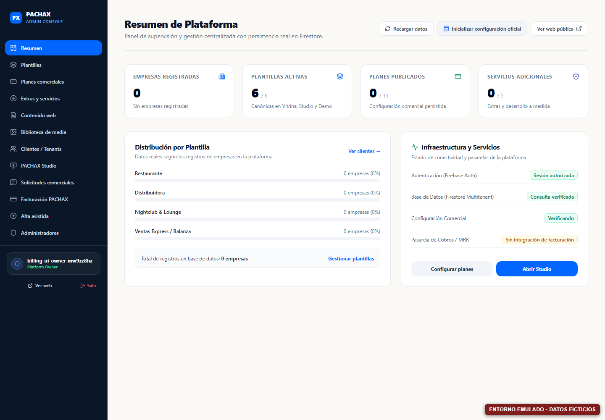
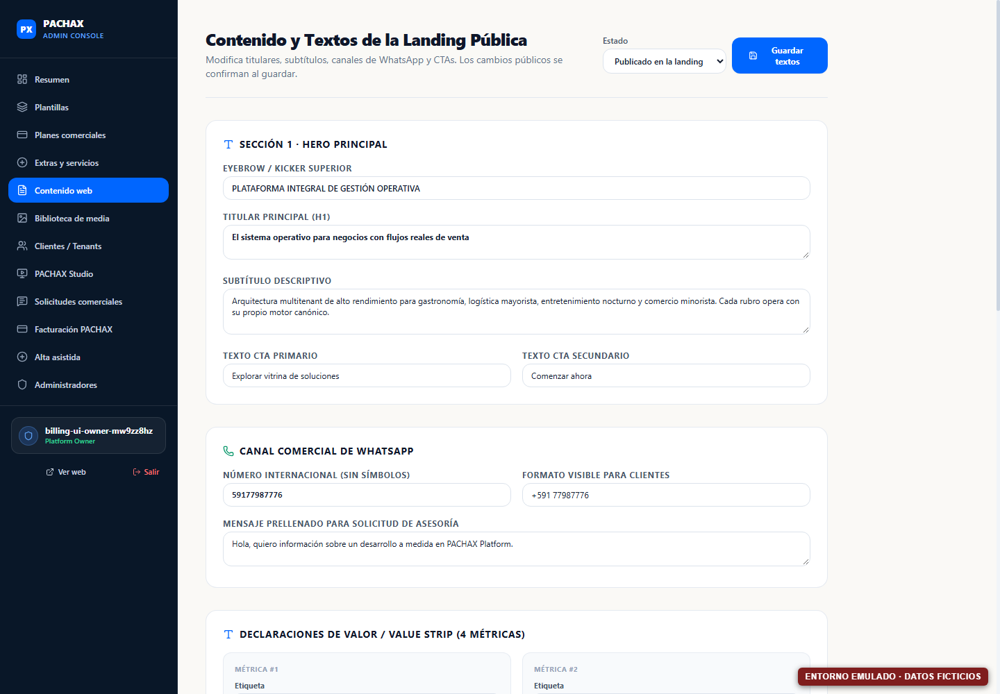
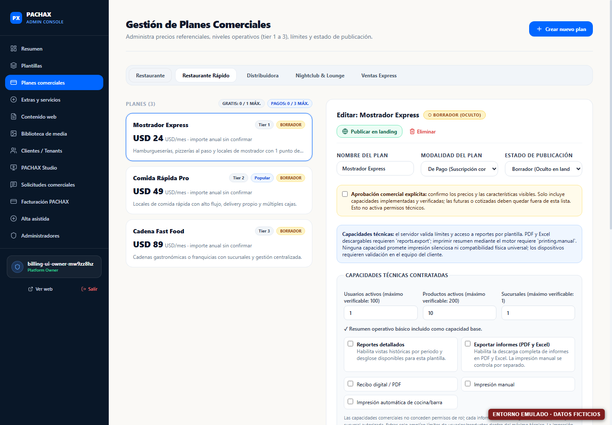
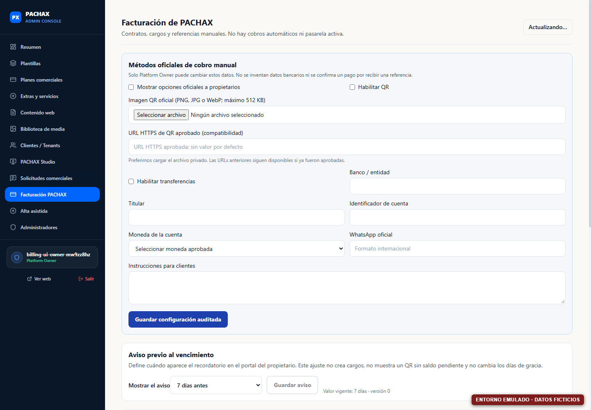
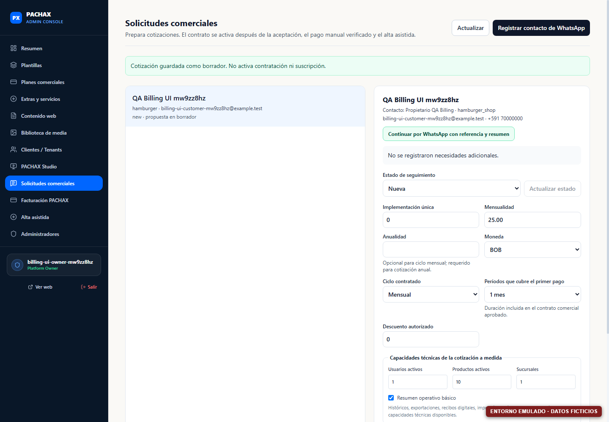
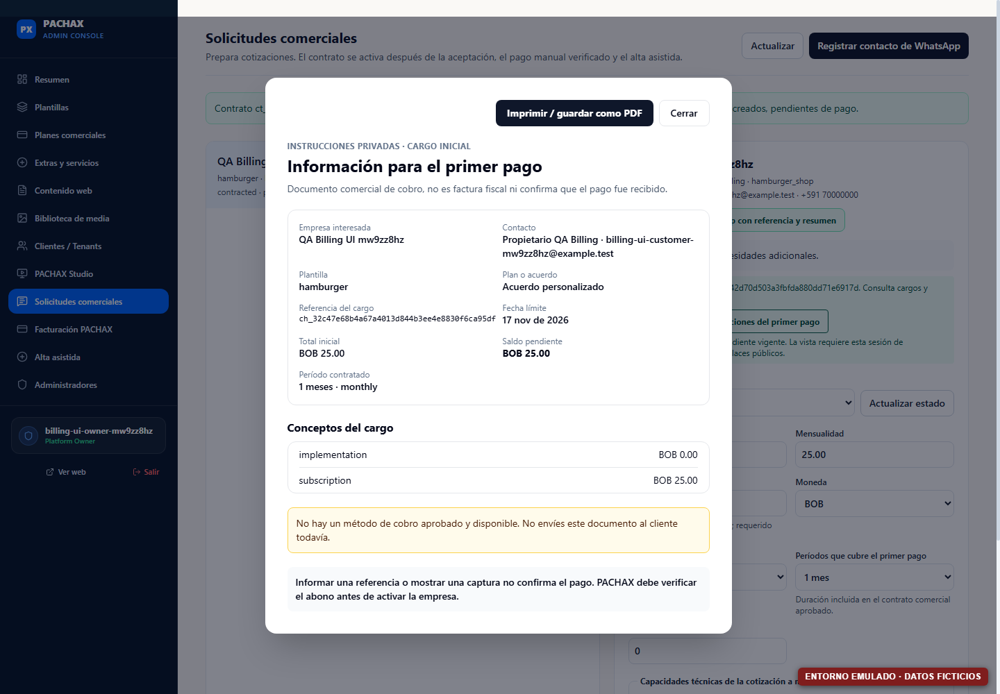
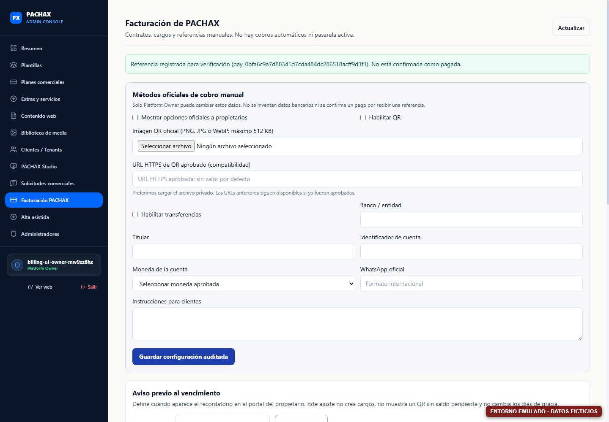
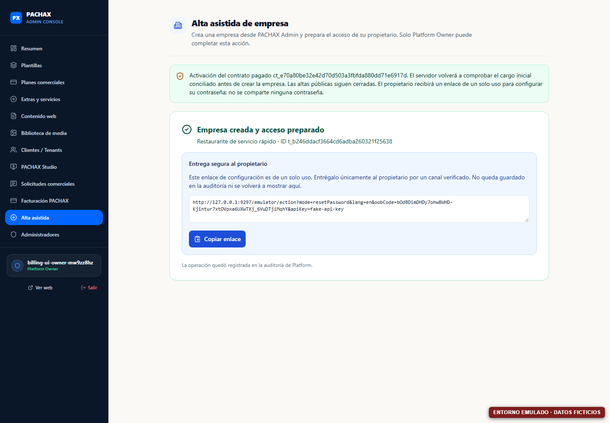
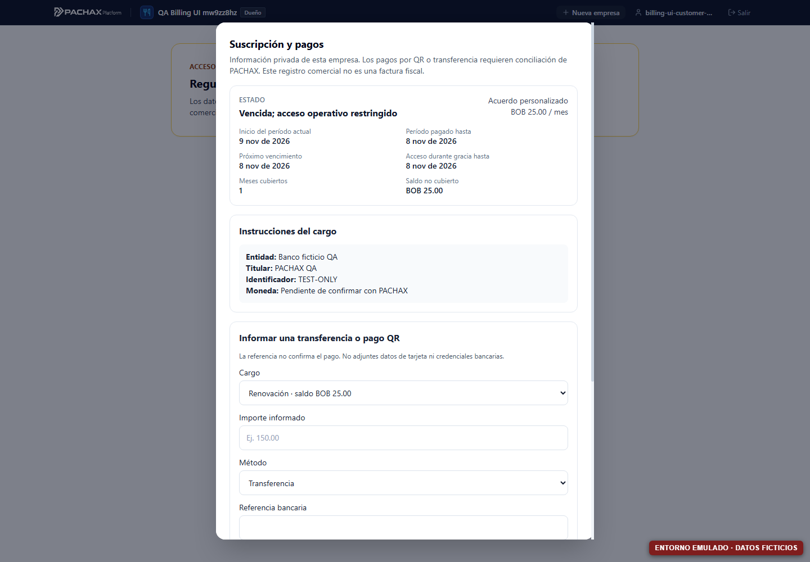

# Guía visual de Administración comercial

Esta guía describe las pantallas que sí están presentes en la base de esta fase. Las imágenes se capturan con Chrome sobre Firebase Emulators, con cuentas y datos ficticios; no representan una configuración ni un cobro de Production. El indicador rojo «ENTORNO EMULADO · DATOS FICTICIOS» forma parte de cada captura.

## Recorrido de preparación

El centro **Preparar ventas** y su lista de ocho áreas están propuestos en el PR #37, que sigue abierto como Draft y no forma parte de esta base apilada. Mientras no se integre, abre cada módulo directamente desde el menú lateral que muestra la captura. El resumen del dashboard informa contadores de tenants, plantillas, planes y extras; no lo tomes como una certificación de disponibilidad comercial.

## Contacto oficial y solicitudes

1. Para cambiar el número y el texto público de WhatsApp, abre **Contenido web → Canal Comercial de WhatsApp**. Guarda solo el número oficial validado por PACHAX. La pantalla controla el contacto de la landing.
2. Para registrar una conversación iniciada por WhatsApp, abre **Solicitudes comerciales → Registrar contacto de WhatsApp**. Esto registra el interesado; no crea plan, contrato, cargo, empresa ni acceso.
3. El visitante que completa el formulario público aparece en Solicitudes comerciales. Desde el detalle se actualiza el seguimiento y se prepara una propuesta no vinculante.

## Plantillas, planes y precios

Abre **Planes comerciales**, selecciona la plantilla y crea o edita el borrador. Allí se configuran descripción, mensualidad, moneda, anualidad como **total por 12 meses**, costo de implementación, niveles, límites y capacidades disponibles en el contrato de la plantilla.

Guarda como borrador mientras se prepara la oferta. La acción **Publicar en landing** tiene una confirmación independiente: publicar una oferta no abre por sí mismo la contratación autónoma. No rellenes anualidad, capacidades o importes a partir de valores sugeridos; utiliza únicamente valores aprobados por PACHAX.

Para las tres modalidades especializadas (Restaurante con salón, Distribución y Nightclub & Lounge), usa **Solicitudes comerciales** para asociar una propuesta a la evaluación de alcance. Los importes de implementación y mensualidad se mantienen separados. La oferta aprobada no elimina la aceptación, contrato ni conciliación antes del alta.

## QR y métodos manuales

Entra en **Facturación PACHAX → Métodos oficiales de cobro manual**. Un Platform Owner puede seleccionar un archivo QR PNG, JPG/JPEG o WebP de hasta 512 KB, revisar la vista previa privada y guardar la configuración. El archivo se almacena de forma privada; la pantalla también reúne banco, titular, identificador de cuenta, moneda, instrucciones y WhatsApp de cobros.

Usa **Habilitar QR** y **Mostrar opciones oficiales a propietarios** solo después de validar por un procedimiento separado el banco y el titular receptor. Una imagen legible no demuestra que el QR pertenezca a PACHAX. Reemplazar o retirar la imagen cambia la referencia oficial y queda sujeto a permisos y auditoría; no se publica por completar la pantalla.

## Primer pago y alta asistida

El orden operativo es:

1. Solicitud y selección de plantilla.
2. Borrador de propuesta/cotización y oferta al interesado.
3. Registrar la aceptación verificada.
4. Crear el contrato y su cargo inicial con fecha límite.
5. Abrir **Vista previa de instrucciones del primer pago** dentro del contrato pendiente.
6. Recibir la referencia del interesado y revisar el pago en **Facturación PACHAX**.
7. Confirmar el ingreso solo tras comprobarlo directamente con el canal bancario oficial.
8. Desde el contrato pagado, abrir **Alta asistida** y crear el tenant. El propietario establece su acceso desde el enlace de un solo uso.

La referencia bancaria o una captura no confirma el pago. La vista de instrucciones se deriva del contrato/cargo existentes, no crea un cargo ni un enlace público, y solo incluye QR/métodos si están configurados y aprobados. Si el método está sin aprobar, la vista debe decirlo y no presentar un QR de ejemplo.

## Avisos y renovaciones

En la misma pantalla de **Facturación PACHAX**, un Platform Owner configura el aviso previo al vencimiento: 3, 7, 15 o 30 días. Este parámetro solo mueve el recordatorio del portal del propietario. No modifica gracia o vencimiento y no crea automáticamente el cargo.

La renovación requiere un cargo administrativo válido. El portal solo muestra QR/instrucciones junto a un cargo elegible con saldo; abrir la pantalla o el aviso no genera deuda. Desde la ficha de facturación puede revisarse el período, la referencia del cargo y los pagos. La captura del portal que se incluye es una sesión de prueba de emulador.

## Autoservicio y disponibilidad

**Restaurante Rápido** y **Comercio/Retail** se consideran candidatos a autoservicio, pero no se debe cambiar un estado de registro a «abierto» sin un flujo de contratación, términos aprobados y pruebas de identidad, precio, cargo, conciliación, entitlements y activación. Publicar un plan solo hace visible la oferta autorizada. Mientras la contratación autónoma esté cerrada, deriva al visitante a la vía de contacto/implementación habilitada.

Para una plantilla especializada, crea una propuesta/cotización apropiada al alcance. No se activa por seleccionar la plantilla ni por guardar una propuesta; requiere aceptación, contrato, cargo y conciliación antes del alta asistida.

## Cómo comprobar las capacidades aplicadas

Después del alta, abre **Clientes / Tenants**, localiza la empresa y confirma el tipo de negocio, estado, suscripción y tenant asociado. La instantánea de capacidades se verifica en el detalle de empresa y coincide con las capacidades contratadas del plan o la propuesta. Los IDs técnicos están disponibles en el detalle para soporte, pero no sustituyen esa comprobación.

## Decisiones de PACHAX pendientes para operar ventas reales

Introduce o aprueba estos datos desde las pantallas indicadas; no están rellenados por esta guía:

| Decisión/dato oficial | Pantalla |
|---|---|
| WhatsApp público y de cobros | Contenido web; Facturación PACHAX |
| Imagen QR, banco, titular, cuenta, moneda e instrucciones | Facturación PACHAX → Métodos oficiales |
| Precio mensual/anual total, costo de implementación y límites por plan | Planes comerciales; Solicitudes comerciales para cotizaciones |
| Capacidades incluidas, extras y exclusiones por oferta | Planes comerciales / Extras y servicios |
| Condiciones, privacidad y documentos exigibles | Aprobación de PACHAX antes de publicar; no se generan desde el asistente |
| Si se abre o no la contratación autónoma | Decisión independiente y certificación del flujo completo; no es el control de publicación del plan |
| Validación de banco/titular receptor | Procedimiento bancario separado, antes de habilitar QR o transferencia |

Los tests y capturas de esta guía usan exclusivamente nombres, importes, números, transferencias y referencias de QA en Firebase Emulators.
